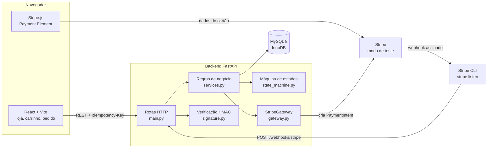
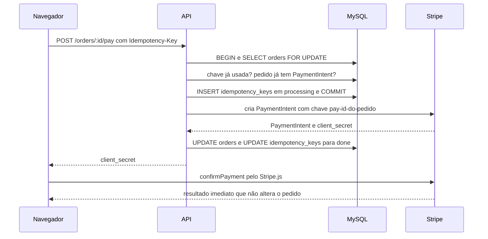
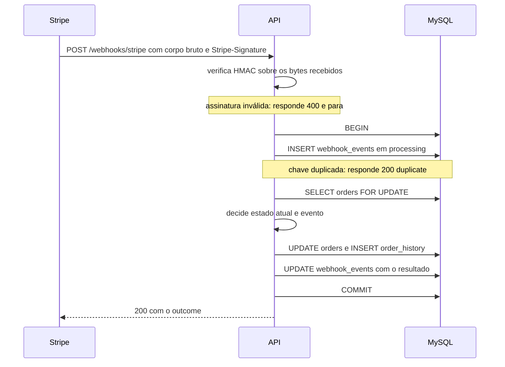

# 01 — Arquitetura e fluxo

Como o **navegador (React)**, a **API (FastAPI)**, o **MySQL** e o **Stripe** trabalham juntos. Para o porquê de cada escolha, veja os [ADRs](adr/README.md); para os contratos exatos, as [Specs](specs/README.md).

## 1. Visão geral



Dois caminhos independentes levam informação ao sistema:

| Caminho | Direção | O que faz | Altera o estado do pagamento? |
|---|---|---|:-:|
| **Síncrono** | navegador → API → Stripe | Cria o pedido e o `PaymentIntent` | **Não** |
| **Assíncrono** | Stripe → API | Entrega o resultado: aprovado, recusado ou estornado | **Sim** (único caminho) |

O **número do cartão nunca passa pela API**: o Payment Element envia os dados direto ao Stripe.

## 2. Os quatro atores

| Ator | Responsabilidade | Guarda o quê |
|---|---|---|
| **Navegador (React)** | Catálogo, carrinho, formulário de cartão, tela do pedido | Carrinho (estado local); a `Idempotency-Key` da tentativa de pagamento |
| **API (FastAPI)** | Regras do negócio, idempotência, autenticação do webhook, máquina de estados | Nada em memória que precise sobreviver: tudo importante vai para o MySQL |
| **MySQL** | Fonte única de estado e **mecanismo de exclusão mútua** (chaves primárias, `UNIQUE`, `FOR UPDATE`) | Pedidos, itens, chaves de idempotência, eventos recebidos, histórico |
| **Stripe** | Processa o cartão; é a fonte da verdade sobre o resultado; notifica por webhook | `PaymentIntent`, cobranças e estornos |

### Credenciais

| Credencial | Onde vive | Para quê |
|---|---|---|
| `pk_test_…` | Backend (`.env`), entregue ao navegador por `GET /config` | Inicializar o Stripe.js |
| `sk_test_…` | Somente backend (`.env`) | Criar `PaymentIntent` |
| `whsec_…` | Somente backend (`.env`) | Verificar a assinatura dos webhooks |
| `client_secret` | Gerado por pagamento; devolvido só por `POST /orders/{id}/pay` | Permite ao navegador confirmar **aquele** pagamento |

## 3. Fluxo passo a passo

### 3.1 Criar o pedido (React → FastAPI → MySQL)

1. O React envia `POST /orders` com apenas `product_id` e `quantity` por item.
2. A API busca os preços em `products`, calcula o total e grava, **numa transação**, `orders` (estado `pendente`), `order_items` e a primeira linha de `order_history` (`pedido_criado`).
3. Devolve o pedido. O navegador nunca informa preço.

### 3.2 Pagar (React → FastAPI → Stripe)



- A `Idempotency-Key` é gerada pelo navegador, **uma por tentativa de pagamento**.
- O `PaymentIntent` leva `metadata.order_id`: é por ele que o webhook encontra o pedido.
- A resposta é guardada em `idempotency_keys`: repetir a chamada devolve a mesma resposta, sem falar com o Stripe.
- Contrato completo: [SPEC-001](specs/SPEC-001-pagamento-idempotente.md).

### 3.3 Confirmar o resultado (Stripe → FastAPI → MySQL)



Eventos tratados: `payment_intent.succeeded` → pago; `payment_intent.payment_failed` → recusado; `charge.refunded` (estorno total) → estornado. Qualquer outro tipo é registrado como `unrelated` e respondido com `200`. Contrato completo: [SPEC-002](specs/SPEC-002-webhook-stripe.md) e [SPEC-003](specs/SPEC-003-maquina-de-estados.md).

### 3.4 Mostrar o resultado (MySQL → FastAPI → React)

A tela do pedido consulta `GET /orders/{id}` a cada 2 s. O estado muda quando o **webhook** é aplicado, não quando o navegador termina o `confirmPayment`.

### 3.5 Enviar o pedido

`POST /orders/{id}/ship` (ação interna) leva `pago → enviado` pela mesma máquina de estados e registra o histórico.

## 4. Para que serve a Stripe CLI

Em desenvolvimento, o Stripe (na internet) não alcança `localhost:8000`. O comando

```bash
stripe listen --api-key sk_test_… --events payment_intent.succeeded,payment_intent.payment_failed,charge.refunded --forward-to http://127.0.0.1:8000/webhooks/stripe
```

abre uma conexão **de saída** com o Stripe, recebe os eventos da conta de teste e os encaminha por `POST` à API local, com `Stripe-Signature`. Ele também imprime o `whsec_…` que assina essas entregas (valor do `STRIPE_WEBHOOK_SECRET`). Em produção, a CLI é substituída por um endpoint HTTPS cadastrado no Dashboard. Veja [ADR-0014](adr/0014-entrega-de-webhooks-em-desenvolvimento.md).

## 5. Camadas do backend

| Módulo | Responsabilidade | HTTP? | Banco? |
|---|---|:-:|:-:|
| `app/main.py` | Rotas, validação de entrada, tradução de erros de domínio em HTTP, entrega do webhook | sim | não direto |
| `app/services.py` | Regras de negócio: pedido, pagamento idempotente, webhook, envio | não | sim |
| `app/state_machine.py` | Tabela de transições e `decide(estado, evento)`. **Pura** | não | não |
| `app/signature.py` | Gera e verifica o HMAC-SHA256. **Pura** | não | não |
| `app/gateway.py` | Único ponto que fala com a API do Stripe | não | não |
| `app/db.py` | Esquema, conexão, `transaction()`, detecção de chave duplicada | não | sim |
| `app/config.py` | Variáveis de ambiente e validação das chaves do Stripe | não | não |

Dependências permitidas: `main → services → (state_machine, gateway, db)`. Módulos de baixo nunca importam os de cima. Erros de negócio são exceções de domínio (`NotFound`, `NotPayable`, `RequestInProgress`, `IdempotencyConflict`, `MalformedEvent`, `GatewayUnavailable`, `InvalidOrder`, `InvalidTransition`), cada uma com seu `status_code`; um único *exception handler* em `main.py` as converte em JSON.

## 6. Estrutura do repositório

```
AGENTS.md                      # regras para quem altera o projeto (pessoas e agentes)
README.md                      # como executar
docs/
  01-arquitetura-e-fluxo.md    # este documento
  02-banco-de-dados.md         # esquema explicado em detalhe
  03-bibliotecas.md            # bibliotecas e por que cada uma
  adr/                         # decisões de arquitetura (uma por arquivo)
  specs/                       # contratos e comportamento esperado
backend/
  app/                         # código da API (camadas acima)
  scripts/demo_webhooks.py     # demonstração com eventos reais do Stripe
  tests/                       # pytest
frontend/
  src/                         # React: App.jsx, api.js, main.jsx, styles.css
```

## 7. Ambientes

| Ambiente | Banco | Stripe | Como os webhooks chegam |
|---|---|---|---|
| **Desenvolvimento** | `loja` (MySQL local) | Conta de teste | `stripe listen` encaminha os eventos reais |
| **Testes (pytest)** | `loja_test`, limpo a cada teste | Real, só nos testes de pagamento (pulados sem chaves) | Payloads de `tests/events.py`, assinados com um segredo de teste |
| **Demonstração** | `loja` | Conta de teste | O script busca eventos reais pela API do Stripe e os entrega ao webhook, assinados com `STRIPE_WEBHOOK_SECRET` |

## 8. O que acontece quando algo falha

| Falha | Consequência | Como o projeto responde |
|---|---|---|
| Duplo clique em "Pagar" | Duas requisições iguais | Trava no navegador; `Idempotency-Key` repetida devolve a mesma resposta; um `PaymentIntent` por pedido |
| Stripe indisponível ao criar o pagamento | `502` ao navegador | A chave é liberada; o cliente repete com a **mesma** chave |
| API cai entre "criou no Stripe" e "gravou no banco" | Chave `processing` abandonada | Expira em 60 s; a nova tentativa recebe o **mesmo** `PaymentIntent` (chave `pay-<id>` no Stripe) |
| Webhook chega duplicado | Mesmo `event_id` várias vezes | `INSERT` na chave primária; `200 duplicate` |
| Webhook chega fora de ordem | `pago` depois de `estornado` | Máquina de estados monotônica; o `pago` atrasado é `ignored` |
| Webhook forjado | POST sem assinatura válida | `400`; nada é gravado |
| API fora do ar quando o webhook chega | O Stripe tenta de novo por um período | Reenvio funciona (nada ficou marcado como processado). Se o período acabar, o pedido fica `pendente`: limitação conhecida (veja [AGENTS.md](../AGENTS.md), "Limitações") |
| Erro no meio do processamento do webhook | Evento parcialmente aplicado? | **Não**: a transação inteira sofre `ROLLBACK`; o reenvio processa de novo |
| MySQL indisponível | Erro `500` | A API não responde `200` ao Stripe, que reenvia |
