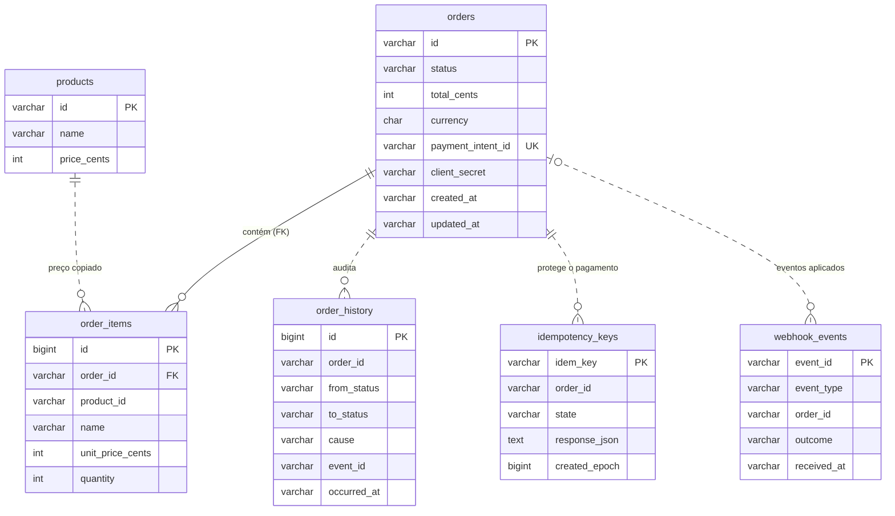

# 02 — Banco de dados

Esquema do MySQL 8 (InnoDB, `utf8mb4`) explicado tabela por tabela, coluna por coluna. A fonte de verdade do DDL é `backend/app/db.py` (`SCHEMA`); as tabelas são criadas automaticamente na subida da API (`init_db`), que também cria o banco se ele não existir.

## 1. Visão geral

Linha contínua = chave estrangeira declarada no MySQL (só `order_items → orders`). Linha tracejada = ligação lógica por `order_id`, sem FK.

As tabelas têm três papéis:

| Papel | Tabelas | Observação |
|---|---|---|
| **Negócio** | `products`, `orders`, `order_items` | O que a loja vende e o que o cliente comprou |
| **Travas** (garantias de correção) | `idempotency_keys`, `webhook_events`, `UNIQUE` em `orders.payment_intent_id` | Existem para que o **banco** impeça duplicidade (ver [ADR-0002](adr/0002-prevencao-de-cobranca-duplicada.md) e [ADR-0003](adr/0003-deduplicacao-de-webhook-por-insert.md)) |
| **Auditoria** | `order_history`, `webhook_events` | Respondem "o que aconteceu com este pedido e por quê" |

## 2. Tabelas

### 2.1 `products` — catálogo

| Coluna | Tipo | Nulo | Chave | Descrição e regra |
|---|---|:-:|---|---|
| `id` | `VARCHAR(64)` | não | **PK** | Identificador legível (`camiseta`, `caneca`…). É o que o navegador envia em `POST /orders` |
| `name` | `VARCHAR(120)` | não | | Nome exibido |
| `price_cents` | `INT` | não | | Preço **em centavos**. `CHECK (price_cents > 0)` (exige MySQL 8.0.16+) |

Carga inicial (`seed_products`, `INSERT IGNORE`): `camiseta` 7990, `caneca` 3490, `mochila` 15900, `adesivos` 1990. Roda a cada subida e não duplica.

### 2.2 `orders` — o pedido (tabela central)

| Coluna | Tipo | Nulo | Chave | Descrição e regra |
|---|---|:-:|---|---|
| `id` | `VARCHAR(40)` | não | **PK** | `ord_` + 16 hexadecimais. Gerado pelo servidor |
| `status` | `VARCHAR(20)` | não | | `pendente`, `recusado`, `pago`, `enviado` ou `estornado`. **Só muda por `_apply_transition`**, depois de `decide()` aprovar (ver [SPEC-003](specs/SPEC-003-maquina-de-estados.md)) |
| `total_cents` | `INT` | não | | Soma calculada no servidor; imutável depois de criado |
| `currency` | `CHAR(3)` | não | | Padrão `'brl'` |
| `payment_intent_id` | `VARCHAR(100)` | **sim** | **UNIQUE** `uq_orders_payment_intent` | `pi_…` do Stripe. `NULL` até o pagamento ser iniciado. O `UNIQUE` garante **no máximo um** pagamento por pedido (MySQL aceita vários `NULL`) |
| `client_secret` | `VARCHAR(255)` | sim | | Guardado para devolver o mesmo segredo se o cliente repetir o pagamento com outra chave. **Nunca** sai em `GET` |
| `created_at` | `VARCHAR(40)` | não | índice `ix_orders_created` | ISO-8601 UTC com microssegundos. Usado para ordenar "pedidos recentes" |
| `updated_at` | `VARCHAR(40)` | não | | Atualizado a cada mudança |

### 2.3 `order_items` — itens do pedido

| Coluna | Tipo | Nulo | Chave | Descrição e regra |
|---|---|:-:|---|---|
| `id` | `BIGINT AUTO_INCREMENT` | não | **PK** | Surrogate key |
| `order_id` | `VARCHAR(40)` | não | **FK** `fk_items_order` → `orders(id)` | Único vínculo com FK declarada do esquema |
| `product_id` | `VARCHAR(64)` | não | | Referência lógica a `products.id` (sem FK, de propósito) |
| `name` | `VARCHAR(120)` | não | | **Cópia** do nome no momento da compra |
| `unit_price_cents` | `INT` | não | | **Cópia** do preço no momento da compra |
| `quantity` | `INT` | não | | 1 a 99 (validado na aplicação) |

O nome e o preço são **copiados** para que o histórico do pedido não mude se o catálogo mudar. Por isso não há FK para `products`.

### 2.4 `idempotency_keys` — trava do `POST /pay`

| Coluna | Tipo | Nulo | Chave | Descrição e regra |
|---|---|:-:|---|---|
| `idem_key` | `VARCHAR(200)` | não | **PK** | Valor do header `Idempotency-Key`. (`key` é palavra reservada no MySQL, por isso o nome) |
| `order_id` | `VARCHAR(40)` | não | índice `ix_idem_order` | Pedido ao qual a chave pertence. A mesma chave em outro pedido é rejeitada |
| `state` | `VARCHAR(12)` | não | | `processing` (reivindicada, esperando o Stripe) ou `done` (resposta guardada) |
| `response_json` | `TEXT` | sim | | Resposta devolvida no replay. `NULL` enquanto `processing` |
| `created_epoch` | `BIGINT` | não | | Segundos desde a época Unix. Chave `processing` com mais de 60 s é considerada abandonada |

Ciclo de vida: `INSERT … processing` → (chamada ao Stripe) → `UPDATE … done`. Se o Stripe falhar, a linha é **apagada**, liberando a chave para nova tentativa.

### 2.5 `webhook_events` — trava e registro dos webhooks

| Coluna | Tipo | Nulo | Chave | Descrição e regra |
|---|---|:-:|---|---|
| `event_id` | `VARCHAR(100)` | não | **PK** | `evt_…` do Stripe. A PK é a **trava de deduplicação** |
| `event_type` | `VARCHAR(100)` | não | | Por exemplo `payment_intent.succeeded` |
| `order_id` | `VARCHAR(40)` | sim | | Pedido afetado; `NULL` para `unrelated` e `unknown_order` |
| `outcome` | `VARCHAR(20)` | não | | `applied`, `ignored`, `unrelated` ou `unknown_order`. Nasce como `processing` **dentro** da transação e é atualizado antes do `COMMIT`, então nunca é visível como `processing` depois |
| `received_at` | `VARCHAR(40)` | não | | ISO-8601 UTC |

Registra **todo** evento aceito (inclusive os ignorados), o que dá rastreabilidade: dá para provar que um `pago` atrasado chegou e foi descartado.

### 2.6 `order_history` — auditoria

| Coluna | Tipo | Nulo | Chave | Descrição e regra |
|---|---|:-:|---|---|
| `id` | `BIGINT AUTO_INCREMENT` | não | **PK** | Define a **ordem** do histórico (`ORDER BY id`) |
| `order_id` | `VARCHAR(40)` | não | índice `ix_hist_order` | |
| `from_status` | `VARCHAR(20)` | sim | | `NULL` na criação |
| `to_status` | `VARCHAR(20)` | não | | |
| `cause` | `VARCHAR(40)` | não | | `pedido_criado`, `pagamento_confirmado`, `pagamento_recusado`, `pagamento_estornado` ou `envio_manual` |
| `event_id` | `VARCHAR(100)` | sim | | `evt_…` que causou a mudança; `NULL` em criação e envio manual |
| `occurred_at` | `VARCHAR(40)` | não | | ISO-8601 UTC |

Só recebe linhas quando o estado **muda de fato**. Eventos ignorados ficam apenas em `webhook_events`.

## 3. Um pedido ao longo do tempo

Caminho feliz com o cartão `4242…`:

| Momento | `orders` | `idempotency_keys` | `webhook_events` | `order_history` |
|---|---|---|---|---|
| **1.** `POST /orders` | `status=pendente`, `payment_intent_id=NULL` | — | — | `NULL → pendente` (`pedido_criado`) |
| **2.** `POST /pay` em andamento | igual | `state=processing`, `response_json=NULL` | — | — |
| **3.** `POST /pay` concluído | `payment_intent_id=pi_…`, `client_secret=…` | `state=done`, `response_json={…}` | — | — |
| **4.** Webhook `payment_intent.succeeded` | `status=pago` | — | `evt_…`, `outcome=applied` | `pendente → pago` (`pagamento_confirmado`, `event_id=evt_…`) |
| **5.** Reenvio do mesmo webhook | — | — | — (o `INSERT` falha com 1062; nada muda) | — |
| **6.** `POST /ship` | `status=enviado` | — | — | `pago → enviado` (`envio_manual`) |
| **7.** Webhook `charge.refunded` | `status=estornado` | — | `evt_…`, `outcome=applied` | `enviado → estornado` (`pagamento_estornado`) |
| **8.** Webhook `pago` atrasado | — | — | `evt_…`, `outcome=ignored` | — |

## 4. Quem garante o quê

| Regra | Garantida por | Onde |
|---|---|---|
| Um evento do Stripe é processado uma vez | **PK** de `webhook_events.event_id` | Banco |
| No máximo um pagamento por pedido | **UNIQUE** `payment_intent_id` + lógica de `pay_order` | Banco + aplicação |
| A mesma `Idempotency-Key` devolve a mesma resposta | **PK** de `idempotency_keys.idem_key` | Banco |
| Preço positivo | `CHECK (price_cents > 0)` | Banco |
| Item pertence a um pedido existente | FK `fk_items_order` | Banco |
| Um pedido por vez em cada operação sensível | `SELECT … FOR UPDATE` na linha de `orders` | Banco (usado pela aplicação) |
| O estado só avança | `state_machine.decide` | Aplicação |
| Quantidade de 1 a 99; produto existente | `create_order` e Pydantic | Aplicação |
| Preço vem do servidor | `create_order` | Aplicação |

## 5. Transações e travas por operação

O nível de isolamento é o padrão do InnoDB (`REPEATABLE READ`). Leituras com `FOR UPDATE` enxergam o dado **mais recente confirmado**. A conexão usa `autocommit=True`; transações explícitas são abertas por `transaction()` (`BEGIN … COMMIT`, ou `ROLLBACK` em qualquer exceção).

| Operação | Transação | Comandos, em ordem |
|---|---|---|
| `create_order` | uma | `SELECT products` → `INSERT orders` → `INSERT order_items` → `INSERT order_history` → `COMMIT` |
| `pay_order` (1ª) | uma | `SELECT orders FOR UPDATE` → `SELECT idempotency_keys` → (se preciso, `DELETE` chave abandonada) → `INSERT idempotency_keys (processing)` → `COMMIT` |
| *(chamada ao Stripe)* | **nenhuma**: fora de qualquer transação | |
| `pay_order` (2ª) | uma | `UPDATE orders` (PI e segredo) → `UPDATE idempotency_keys (done)` → `COMMIT` |
| `pay_order` (falha do Stripe) | uma | `DELETE idempotency_keys` → `COMMIT` |
| `process_webhook` | uma | `INSERT webhook_events` → `SELECT orders FOR UPDATE` → `UPDATE orders` → `INSERT order_history` → `UPDATE webhook_events` → `COMMIT` |
| `ship_order` | uma | `SELECT orders FOR UPDATE` → `UPDATE orders` → `INSERT order_history` → `COMMIT` |
| Leituras (`get_order`, `list_orders`, `products`) | nenhuma | `SELECT` simples em `autocommit` |

Comportamentos do InnoDB dos quais o projeto depende:

1. **`INSERT` em chave primária/`UNIQUE` duplicada espera.** Se outra transação ainda não terminou e já inseriu a mesma chave, a segunda **espera** o `COMMIT`/`ROLLBACK` da primeira. Em seguida, falha com o erro **1062** (se a primeira confirmou) ou conclui (se a primeira desfez).
2. **`SELECT … FOR UPDATE` trava a linha** até o fim da transação. Outras transações que tentem travar a mesma linha esperam.
3. **`UNIQUE` aceita vários `NULL`**: pedidos sem pagamento iniciado não colidem.

**Ordem de travas (evita *deadlock*):** no webhook, primeiro a linha de `webhook_events` e depois a de `orders`; no pagamento, primeiro `orders` e depois `idempotency_keys`. Nunca na ordem inversa dentro da mesma operação.

## 6. Decisões de modelagem

| Decisão | Motivo |
|---|---|
| Ids como texto (`ord_…`, `evt_…`, `pi_…`) | São os identificadores nativos do Stripe e legíveis em logs; não há necessidade de inteiros |
| Datas como `VARCHAR` ISO-8601 UTC | Ordenável, sem conversão de fuso do driver e direto em JSON |
| `price_cents`, `total_cents` em `INT` | Centavos inteiros: sem erro de arredondamento (ver [ADR-0009](adr/0009-dinheiro-em-centavos-e-preco-no-servidor.md)) |
| Nome e preço copiados em `order_items` | O pedido é um **registro histórico** |
| Sem FK nas tabelas de trava e auditoria | Um evento de pedido desconhecido (`unknown_order`) precisa ser registrado mesmo sem pedido |
| `ENGINE=InnoDB`, `utf8mb4` | Transações, travas por linha e acentos/emojis |
| `idem_key` (não `key`) e `event_type` (não `type`) | Evita palavras reservadas e ambíguas do MySQL |
| `AUTO_INCREMENT` só onde a ordem importa (`order_history`) | Os demais ids vêm de fora ou são gerados pela aplicação |

## 7. Bancos e dados de teste

| Banco | Uso | Observação |
|---|---|---|
| `loja` | Desenvolvimento e demonstração (`MYSQL_DATABASE`) | Criado na subida da API |
| `loja_test` | pytest (`MYSQL_TEST_DATABASE`) | Diferente do anterior (a suíte recusa rodar se forem iguais). Tabelas esvaziadas a cada teste, na ordem `order_items → order_history → webhook_events → idempotency_keys → orders` |

Os testes de webhook inserem `orders.payment_intent_id` diretamente por SQL, só para criar o vínculo pedido ↔ pagamento sem chamar o Stripe.
