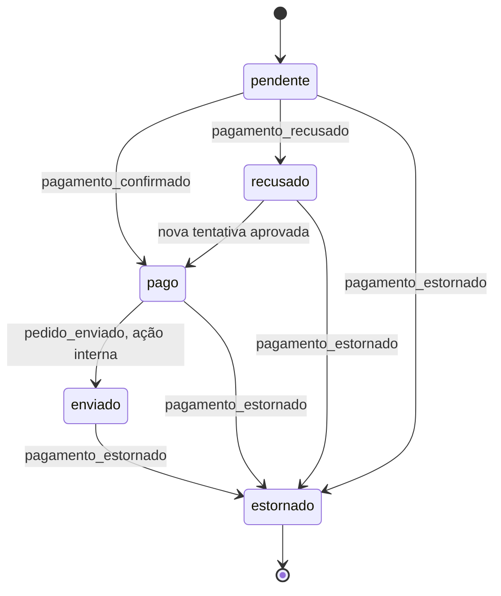

# SPEC-003 — Máquina de estados do pedido

- **Status:** Vigente
- **Decisão relacionada:** [ADR-0005](../adr/0005-maquina-de-estados-monotonica.md)
- **Implementação:** `backend/app/state_machine.py` (módulo **puro**, sem I/O); aplicada em `services._apply_transition`

## 1. Estados e eventos

| Estado | Significado | Ordem |
|---|---|:-:|
| `pendente` | Pedido criado; pagamento não confirmado | 0 |
| `recusado` | O Stripe recusou a tentativa de pagamento | 1 |
| `pago` | Pagamento aprovado | 2 |
| `enviado` | Pedido despachado (ação interna) | 3 |
| `estornado` | Pagamento devolvido (**terminal**) | 4 |

| Evento do domínio | Origem |
|---|---|
| `pagamento_confirmado` | Webhook `payment_intent.succeeded` |
| `pagamento_recusado` | Webhook `payment_intent.payment_failed` |
| `pagamento_estornado` | Webhook `charge.refunded` (estorno total) |
| `pedido_enviado` | Ação interna `POST /orders/{id}/ship` |

## 2. Transições permitidas

| De | Evento | Para | Observação |
|---|---|---|---|
| `pendente` | `pagamento_confirmado` | `pago` | |
| `recusado` | `pagamento_confirmado` | `pago` | O cliente tentou de novo e passou |
| `pendente` | `pagamento_recusado` | `recusado` | |
| `pago` | `pedido_enviado` | `enviado` | |
| `pendente` | `pagamento_estornado` | `estornado` | O estorno chegou **antes** do `pago` |
| `recusado` | `pagamento_estornado` | `estornado` | Idem |
| `pago` | `pagamento_estornado` | `estornado` | |
| `enviado` | `pagamento_estornado` | `estornado` | |

## 3. Regra para combinações fora da tabela

`decide(estado, evento)` devolve `applied = false` e o **mesmo** estado. Nada muda no pedido nem em `order_history`; o evento é registrado em `webhook_events` com `outcome = ignored`.

Exemplos relevantes:

| Estado | Evento | Resultado | Motivo |
|---|---|---|---|
| `estornado` | `pagamento_confirmado` | ignorado | `pago` atrasado não ressuscita um pedido estornado |
| `pago` | `pagamento_recusado` | ignorado | Tentativa antiga não derruba um pedido pago |
| `pago` ou `enviado` | `pagamento_confirmado` | ignorado | Já está pago |
| `pendente`, `recusado` ou `estornado` | `pedido_enviado` | ignorado (a API responde `409`) | Só pedidos pagos são enviados |
| `estornado` | qualquer evento | ignorado | Estado terminal |

## 4. Invariantes

| # | Invariante |
|---|---|
| S1 | **O estado só avança:** toda transição aplicada leva a um estado de ordem **maior** |
| S2 | `estornado` é **terminal**: nenhum evento o altera |
| S3 | **Convergência:** qualquer permutação de `{confirmado, recusado, estornado}` a partir de `pendente` termina em `estornado`; de `{confirmado, recusado}`, em `pago` |
| S4 | A decisão **não depende de timestamps** de evento |
| S5 | Toda mudança de `orders.status` passa por `decide` e é registrada em `order_history` |

## 5. Casos de aceite

| # | Cenário | Teste |
|---|---|---|
| S-A1 | Fluxo feliz `pendente → pago → enviado` | `test_fluxo_feliz` |
| S-A2 | `recusado` seguido de nova tentativa aprovada | `test_recusado_e_nova_tentativa_aprovada` |
| S-A3 | `estornado` é terminal, a partir de qualquer estado | `test_estornado_e_terminal` |
| S-A4 | `pago` depois de `estornado` é ignorado | `test_pago_depois_de_estornado_e_ignorado` |
| S-A5 | `recusado` atrasado não derruba `pago` | `test_recusado_atrasado_nao_derruba_pedido_pago` |
| S-A6 | Não se envia pedido que não está pago | `test_nao_envia_pedido_nao_pago` |
| S-A7 | O estado só avança (S1) | `test_o_estado_so_avanca` |
| S-A8 | Convergência (S3), todas as permutações | `test_qualquer_ordem_chega_no_mesmo_estado_final`, `test_recusado_e_pago_em_qualquer_ordem_termina_pago` |
